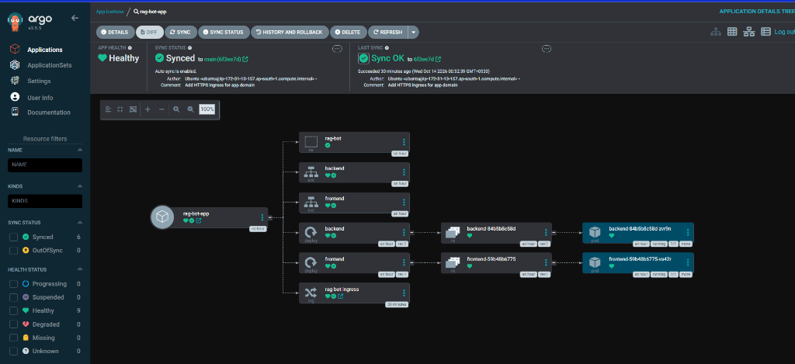
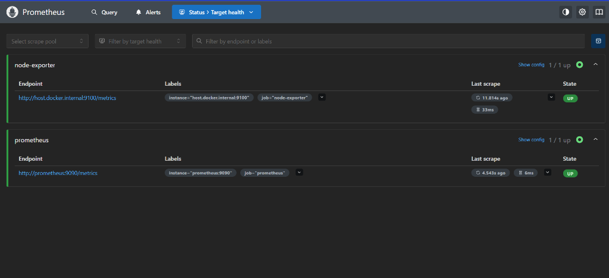
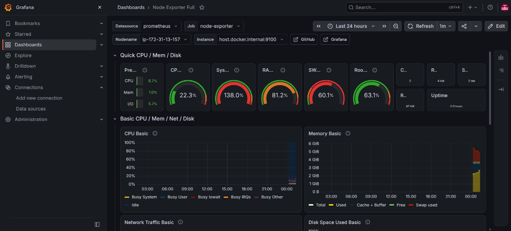
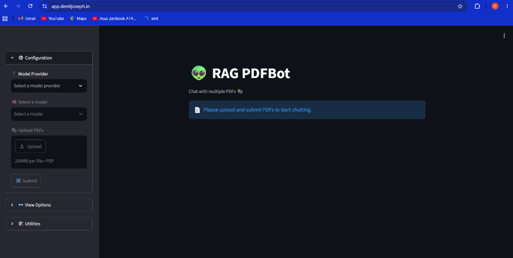

# 🚀 RAG PDF Bot — AWS CI/CD & Observability

> **Study project documentation** — covers the RAG PDF Bot from local containers through AWS EKS deployment, CI/CD (Jenkins + SonarQube), GitOps (Argo CD), monitoring (Prometheus + Grafana), and a custom HTTPS domain.
> Written for a single-node EKS study environment. Always verify resource names and costs in your own AWS account.
>
> 📖 **Application Documentation**: For local development, FastAPI backend, and Streamlit frontend details, see [APP_README.md](APP_README.md).

---

## 📋 Table of Contents

1. [Architecture](#architecture)
2. [Application Containers — What the Dockerfiles Do](#application-containers--what-the-dockerfiles-do)
3. [Install Docker, Jenkins & SonarQube on the EC2 Host](#install-docker-jenkins-and-sonarqube-on-the-ec2-host)
4. [Resources & Values Used](#resources-and-values-used)
5. [Start the EC2 Administration Host](#1-start-the-ec2-administration-host)
6. [AWS Permissions & CLI Tools](#2-aws-permissions-and-cli-tools)
7. [Create the EKS Cluster](#3-create-the-eks-cluster)
8. [Install Argo CD](#4-install-argo-cd)
9. [Configure Secrets & Deploy with Argo CD](#5-configure-application-secrets-and-deploy-with-argo-cd)
10. [Jenkins & SonarQube CI/CD](#6-jenkins-and-sonarqube-cicd)
11. [Prometheus & Grafana](#7-prometheus-and-grafana)
12. [Connect a Domain & Enable HTTPS](#8-connect-a-domain-and-enable-https)
13. [Routine Checks](#9-routine-checks)
14. [Stop Resources & Avoid Charges](#10-stop-resources-and-avoid-ongoing-charges)
15. [Security Reminders](#security-reminders)

---

## Architecture

```
Developer push → GitHub → Jenkins → SonarQube → Docker images → Amazon ECR
                                  ↓
                     Jenkins updates k8s manifests
                                  ↓
          GitHub manifests → Argo CD on EKS → backend + frontend pods

Browser → app.denitjoseph.in (Route 53)
       → HTTPS load balancer (ALB)
       → Ingress → frontend Service

EC2 host (separate from EKS):
  Jenkins · SonarQube · Prometheus + Grafana + Node Exporter (Docker Compose)
```

### Where Each Component Runs

| Location | Components |
|---|---|
| **EC2 Ubuntu admin host** | Jenkins (systemd, port 8080), SonarQube (Docker, port 9000), Prometheus + Grafana + Node Exporter (Docker Compose — local access only), Docker, aws, eksctl, kubectl, helm |
| **AWS EKS `rag-bot-eks` (one t3.medium)** | Argo CD (`argocd` ns), backend + frontend pods + Ingress (`rag-bot` ns), AWS Load Balancer Controller |
| **External** | GitHub (code & manifests), Amazon ECR (images), Route 53 + ACM (DNS & certificate) |

> ⚠️ The frontend is public. The backend is an internal `ClusterIP` service. Keep Argo CD and Grafana **private or access-restricted**.

---

## Application Containers — What the Dockerfiles Do

The project uses **Python 3.11** and a **two-stage build**. The builder stage installs Python packages; the runtime image copies those packages and the application source.

### `backend/Dockerfile`

```dockerfile
FROM python:3.11-slim AS builder
WORKDIR /app
RUN apt-get update && apt-get install -y --no-install-recommends build-essential \
    && rm -rf /var/lib/apt/lists/*
COPY requirements.txt .
RUN pip install --upgrade pip && \
    pip install --no-cache-dir --prefix=/install \
    --extra-index-url https://download.pytorch.org/whl/cpu \
    -r requirements.txt

FROM python:3.11-slim
WORKDIR /app
COPY --from=builder /install /usr/local
COPY . .
RUN mkdir -p /app/temp/uploaded_files /app/data
EXPOSE 8000
CMD ["uvicorn", "main:app", "--host", "0.0.0.0", "--port", "8000"]
```

### `frontend/Dockerfile`

```dockerfile
FROM python:3.11-slim AS builder
WORKDIR /app
COPY requirements.txt .
RUN pip install --upgrade pip && \
    pip install --prefix=/install --no-cache-dir -r requirements.txt

FROM python:3.11-slim
WORKDIR /app
COPY --from=builder /install /usr/local
COPY . .
EXPOSE 8501
HEALTHCHECK --interval=30s --timeout=5s --start-period=20s --retries=3 \
  CMD python -c "import urllib.request; urllib.request.urlopen('http://127.0.0.1:8501/_stcore/health', timeout=3)" || exit 1
CMD ["streamlit", "run", "app.py", "--server.port=8501", "--server.address=0.0.0.0"]
```

> The frontend health check uses Python's standard library — no `curl` needed in the slim image.
> Kubernetes should also have readiness/liveness probes in `k8s/deployment.yaml`.

### Build & Run Locally

```bash
# Build from repository root
docker build -t rag-bot-backend:local ./backend
docker build -t rag-bot-frontend:local ./frontend
```

Use the checked-in `docker-compose.yml` for local development (ensure `backend/.env` exists and is git-ignored):

```bash
docker compose up --build
docker compose ps
docker compose logs -f backend frontend
```

| Service | URL |
|---|---|
| Frontend | http://localhost:8501 |
| Backend API docs | http://localhost:8000/docs |

Stop with `docker compose down`. Do **not** add `--volumes` unless intentionally deleting local data.

---

## Install Docker, Jenkins and SonarQube on the EC2 Host

### Docker Engine & Compose Plugin

```bash
sudo apt update
sudo apt install -y ca-certificates curl
sudo install -m 0755 -d /etc/apt/keyrings
sudo curl -fsSL https://download.docker.com/linux/ubuntu/gpg \
    -o /etc/apt/keyrings/docker.asc
sudo chmod a+r /etc/apt/keyrings/docker.asc

sudo tee /etc/apt/sources.list.d/docker.sources >/dev/null <<EOF
Types: deb
URIs: https://download.docker.com/linux/ubuntu
Suites: $(. /etc/os-release && echo "${UBUNTU_CODENAME:-$VERSION_CODENAME}")
Components: stable
Architectures: $(dpkg --print-architecture)
Signed-By: /etc/apt/keyrings/docker.asc
EOF

sudo apt update
sudo apt install -y docker-ce docker-ce-cli containerd.io \
    docker-buildx-plugin docker-compose-plugin
sudo systemctl enable --now docker
sudo docker run --rm hello-world

# Allow Jenkins to use Docker
sudo usermod -aG docker jenkins
sudo systemctl restart jenkins
```

> ⚠️ Docker group membership grants root-equivalent host control. Only do this on a trusted CI server.

### Jenkins LTS

```bash
sudo apt update
sudo apt install -y fontconfig openjdk-21-jre wget
java -version

sudo wget -O /etc/apt/keyrings/jenkins-keyring.asc \
    https://pkg.jenkins.io/debian-stable/jenkins.io-2026.key
echo "deb [signed-by=/etc/apt/keyrings/jenkins-keyring.asc] https://pkg.jenkins.io/debian-stable binary/" \
    | sudo tee /etc/apt/sources.list.d/jenkins.list >/dev/null

sudo apt update
sudo apt install -y jenkins
sudo systemctl enable --now jenkins
sudo systemctl status jenkins --no-pager
```

Open `http://<EC2_PUBLIC_IP>:8080`. Initial password:

```bash
sudo cat /var/lib/jenkins/secrets/initialAdminPassword
```

#### Required Jenkins Credentials & Tools

| Credential / Tool | Purpose |
|---|---|
| AWS credentials ID `jenkins-aws-ecr` | ECR login and image push |
| GitHub write credential (referenced in Jenkinsfile) | Push the manifest image-tag commit |
| Secret text — SonarQube token | Jenkins-to-SonarQube authentication |
| SonarQube server name `SonarQube` | Must match `withSonarQubeEnv('SonarQube')` |
| SonarScanner tool name `SonarScanner` | Must match `tool 'SonarScanner'` |

### SonarQube Community Build

Set kernel parameters first:

```bash
sudo tee /etc/sysctl.d/99-sonarqube.conf >/dev/null <<'EOF'
vm.max_map_count=524288
fs.file-max=131072
EOF
sudo sysctl --system
```

Run with persistent volumes:

```bash
docker volume create sonarqube_data
docker volume create sonarqube_extensions
docker volume create sonarqube_logs

docker run -d --name sonarqube \
    --restart unless-stopped \
    -p 9000:9000 \
    -v sonarqube_data:/opt/sonarqube/data \
    -v sonarqube_extensions:/opt/sonarqube/extensions \
    -v sonarqube_logs:/opt/sonarqube/logs \
    sonarqube:community
```

Open `http://<EC2_PUBLIC_IP>:9000`, complete setup, create a project token, save it as a Jenkins **Secret text** credential.

#### Connect Jenkins to SonarQube

1. Add the SonarQube token as a **Secret text** credential.
2. **Manage Jenkins → System** → add SonarQube server named exactly `SonarQube`.
3. **Manage Jenkins → Tools** → add SonarScanner installation named exactly `SonarScanner` (automatic install).

The Jenkinsfile uses `withSonarQubeEnv('SonarQube')`, project key `rag-bot-fastapi`, source paths `backend,frontend`.

> **Official references:** [Docker Engine on Ubuntu](https://docs.docker.com/engine/install/ubuntu/) · [Jenkins on Linux](https://www.jenkins.io/doc/book/installing/linux/) · [SonarQube Docker setup](https://docs.sonarsource.com/sonarqube-server/latest/server-installation/from-docker-image/starting-sonarqube-container/)

---

## Resources and Values Used

| Item | Value |
|---|---|
| AWS region | `ap-south-1` |
| EKS cluster | `rag-bot-eks` |
| EKS node group | `rag-bot-nodes` |
| EKS worker size / count | `t3.medium`, 1 node (study) |
| ECR backend repository | `rag-bot-backend` |
| ECR frontend repository | `rag-bot-frontend` |
| Kubernetes app namespace | `rag-bot` |
| Argo CD namespace | `argocd` |
| Monitoring | Docker Compose on EC2 (`monitoring/`) |
| Domain registrar | GoDaddy |
| DNS hosting | Amazon Route 53 public hosted zone — `denitjoseph.in` |
| Application hostname | `app.denitjoseph.in` |
| TLS certificate | ACM in `ap-south-1` for `app.denitjoseph.in` |

> EC2 public IPs and ALB hostnames change — look them up when needed, do not treat old addresses as permanent.

---

## 1. Start the EC2 Administration Host

Start the existing Ubuntu EC2 instance. Connect using the current public IP and your EC2 key.

```bash
sudo systemctl status jenkins --no-pager
docker ps
free -h
df -h /
```

| Service | URL |
|---|---|
| Jenkins | `http://<EC2_PUBLIC_IP>:8080` |
| SonarQube | `http://<EC2_PUBLIC_IP>:9000` |

> Restrict inbound SSH to your current IP. Access Jenkins/SonarQube through an SSH tunnel rather than opening ports to `0.0.0.0/0`.

---

## 2. AWS Permissions and CLI Tools

The `eksctl` identity needs permission for: EKS, CloudFormation stacks, VPC/networking, EC2 instances/security groups, Auto Scaling, IAM roles (`iam:PassRole`), and `eks:DescribeAddonVersions`.

The **Jenkins ECR identity** needs only ECR auth and push for the two repositories. Never give Jenkins broad IAM administration rights just to push images. Store access keys in Jenkins Credentials — never in Git.

```bash
aws sts get-caller-identity
aws --version && eksctl version && kubectl version --client && helm version
```

```bash
export KUBECONFIG=/home/ubuntu/.kube/config
```

---

## 3. Create the EKS Cluster

```bash
eksctl create cluster \
    --name rag-bot-eks \
    --region ap-south-1 \
    --nodegroup-name rag-bot-nodes \
    --node-type t3.medium \
    --nodes 1 \
    --nodes-min 1 \
    --nodes-max 1
```

Verify when complete:

```bash
export KUBECONFIG=/home/ubuntu/.kube/config
kubectl get nodes -o wide
kubectl get pods -A
```

Wait for node to be `Ready` and system pods `Running` before proceeding.

---

## 4. Install Argo CD

```bash
kubectl create namespace argocd
kubectl apply -n argocd \
    -f https://raw.githubusercontent.com/argoproj/argo-cd/stable/manifests/install.yaml
kubectl get pods -n argocd -w
```

### Access the UI via SSH Port-Forward

On EC2:
```bash
kubectl port-forward -n argocd svc/argocd-server 8081:443
```

On your local machine (PowerShell):
```powershell
ssh -i "C:\path\to\key.pem" -L 8081:localhost:8081 ubuntu@<EC2_PUBLIC_IP>
```

Open `https://localhost:8081`. Get initial admin password:

```bash
kubectl -n argocd get secret argocd-initial-admin-secret \
    -o jsonpath='{.data.password}' | base64 -d; echo
```

> Change the initial password after first login. Never commit it.

---

## 5. Configure Application Secrets and Deploy with Argo CD

```bash
cd ~
git clone https://github.com/denitjoseph/rag-bot-fastapi.git
cd rag-bot-fastapi
```

Create namespace and secret from the private backend `.env`:

```bash
kubectl create namespace rag-bot --dry-run=client -o yaml | kubectl apply -f -

kubectl create secret generic rag-backend-secrets \
    -n rag-bot \
    --from-env-file=backend/.env \
    --dry-run=client -o yaml | kubectl apply -f -
```

### Repository Layout

```
argocd/application.yaml   # Argo CD Application pointing at k8s/
k8s/deployment.yaml       # backend/frontend Deployments and Services
k8s/ingress.yaml          # ALB Ingress with HTTPS
Jenkinsfile               # CI, image publishing, manifest update
backend/.env              # Private config — DO NOT COMMIT
```

Apply the Argo CD Application:

```bash
kubectl apply -n argocd -f argocd/application.yaml
kubectl get applications -n argocd
kubectl get pods,services -n rag-bot
```

Target state: **Synced** + **Healthy**.

```bash
kubectl get svc,ingress -n rag-bot
```

### Argo CD — Application Healthy & Synced



---

## 6. Jenkins and SonarQube CI/CD

### Pipeline Stages

| Stage | Action |
|---|---|
| **Checkout** | Clone the repository |
| **SonarQube Analysis** | Scan `backend,frontend` |
| **Build Images** | Build backend + frontend tagged with Jenkins build number |
| **Push to ECR** | Login to ECR and push both images |
| **Update Manifest** | Patch image tags in `k8s/deployment.yaml`, commit + push to `main` |
| **Auto-Deploy** | Argo CD detects the Git change and syncs the deployment |

After a successful build:

```bash
kubectl get pods -n rag-bot
kubectl rollout status deployment/backend -n rag-bot
kubectl rollout status deployment/frontend -n rag-bot
```

> The Jenkinsfile includes loop-prevention logic so manifest-only commits do not trigger endless builds.

---

## 7. Prometheus and Grafana

Prometheus, Grafana, and Node Exporter run on the **EC2 host** via Docker Compose — completely separate from the EKS cluster. Files are in `monitoring/`.

```bash
cd ~/rag-bot-fastapi/monitoring
docker compose up -d
docker compose ps
```

The Compose file binds interfaces to `127.0.0.1` — not exposed to the public internet. Access via SSH tunnel:

```bash
ssh -i "C:\path\to\key.pem" \
    -L 3000:localhost:3000 \
    -L 9090:localhost:9090 \
    ubuntu@<EC2_PUBLIC_IP>
```

| Service | Local URL |
|---|---|
| Grafana | http://localhost:3000 |
| Prometheus | http://localhost:9090/targets |

Import the **Node Exporter Full** dashboard (ID `1860`) in Grafana with Prometheus as the data source.

### Prometheus — Target Health



### Grafana — Node Exporter Full Dashboard



> This setup monitors the **EC2 host only**, not EKS worker nodes. For cluster metrics, install a separate Kubernetes monitoring stack.

---

## 8. Connect a Domain and Enable HTTPS

Registered domain: **`denitjoseph.in`** (GoDaddy), nameservers delegated to Route 53.
Application hostname: **`app.denitjoseph.in`**

### Setup Steps

1. Request an **ACM certificate** in `ap-south-1` for `app.denitjoseph.in` → validate via DNS record ACM provides.
2. Install the **AWS Load Balancer Controller** in EKS with required IAM role and service account.
3. Apply `k8s/ingress.yaml` — attaches the ACM certificate, adds HTTPS listener (port 443), redirects HTTP → HTTPS.
4. Wait for ALB provisioning, verify target group health.
5. In Route 53, create an **A record (Alias)** for `app.denitjoseph.in` → Ingress ALB in `ap-south-1`.
6. Test `https://app.denitjoseph.in` and confirm valid certificate.

> Backend Service stays as `ClusterIP` (internal only). The ALB + Ingress provide public HTTPS access. Do not use a changing EC2 IP for app DNS.

### Live Application at app.denitjoseph.in



---

## 9. Routine Checks

```bash
export KUBECONFIG=/home/ubuntu/.kube/config

kubectl get nodes
kubectl get pods -A
kubectl get applications -n argocd
kubectl get svc -A
kubectl top nodes
kubectl top pods -A
```

### Troubleshoot the App

```bash
kubectl logs deployment/backend -n rag-bot --since=10m
kubectl logs deployment/frontend -n rag-bot --since=10m
kubectl describe pods -n rag-bot
kubectl get events -A --sort-by=.metadata.creationTimestamp | tail -30
```

> Do not share logs that may contain tokens, user data, or uploaded document contents.

---

## 10. Stop Resources and Avoid Ongoing Charges

> ⚠️ Stopping EC2 does **not** stop EKS charges. Worker nodes, load balancers, and storage continue to bill.

```bash
eksctl delete cluster --name rag-bot-eks --region ap-south-1 --wait
eksctl get cluster --region ap-south-1
```

Verify cleanup in the AWS console — check EC2, EKS, Load Balancers, EBS volumes, and CloudFormation.

| Resource | Status after `eksctl delete` |
|---|---|
| EKS cluster, Argo CD, app pods | ✅ Deleted |
| Docker Compose monitoring on EC2 | ❌ Still running — stop separately |
| GitHub source & ECR images | ❌ Remain — delete separately if needed |
| EC2 host + Elastic IP / EBS | ❌ Stop/terminate separately |

On the next study session: recreate the cluster → reinstall Argo CD → reapply the Kubernetes secret from your private `.env`.

---

## Security Reminders

- ❌ **Never commit** `.env`, API keys, AWS credentials, Jenkins/Argo CD/Grafana passwords.
- 🔑 Use **Jenkins Credentials** for GitHub tokens — never put them in the `Jenkinsfile` source.
- 🔄 **Rotate** any secret that was pasted into a chat or otherwise exposed.
- 🔒 **Restrict** EC2 security group rules to your trusted source IPs only.
- 📋 Use **least-privilege IAM policies** and review AWS billing after creating EKS/load balancers.
- ⚠️ The single-node cluster and temporary PDF storage are for **learning, not production**.

---

<div align="center">

Built with ❤️ by **[denitjoseph](https://github.com/denitjoseph)**

*RAG PDF Bot · FastAPI · Streamlit · AWS EKS · Argo CD · Jenkins · SonarQube · Prometheus · Grafana*

</div>
